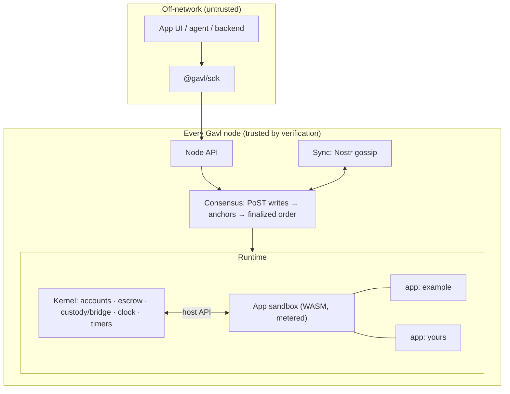

# Gavl Runtime (design note)

Status: **proposal — not yet implemented.** Hard fork: new genesis, new state format, new
`appRoot`. Supersedes the asset-facet sketch in [`composable-assets.md`](composable-assets.md)
(its content idea survives here as app storage; its external-value-feed facet was dropped when
Gavl became a gBTC exchange with no external price input).

## Goal

Gavl becomes a **trust layer for apps with built-in value**. A developer writes an app; the
network — not the developer's server — runs the part that moves money, built only from public
primitives that any other app can use.

The developer's promise, in one line:

> Your app's money logic runs on every Gavl node, in the same order, with the same result.
> You can't rug your users, Gavl can't print gBTC, and no server has to stay up.

## What exists today (and what changes)

Today the layers below the app are already app-agnostic. `consensus/` "never imports app
state" (`src/market/btc.ts` `finalizedView`), and `Write.payload` is "opaque at the chain
layer" (`src/chain/writer.ts`). Everything above that is one hardcoded app:

| Today | Where | Problem for a runtime |
|---|---|---|
| `View = { bridge, custody }` | `src/market/btc.ts` | one fixed state shape |
| `applyOp` — one 10-case `switch` | `src/market/btc.ts` | adding an app = editing consensus code |
| `KINDS` op whitelist | `src/market/ops.ts` | closed vocabulary |
| `viewRoot` = one hash over everything | `src/market/state.ts` | no per-app proofs for light clients |
| channel = a plain network label (e.g. `gavl-testnet`) | `daemon.ts` | custody committee per channel |

What stays untouched: `chain/`, `pot/`, `pos/`, `consensus/` (ordering, finality, anchors),
`sync/` (Nostr transport), `det/`, and the custody cryptography in `custody/`.

## Architecture



Three tiers:

1. **Consensus (unchanged).** PoST-cooldown writes, anchor chain, finality depth `k`,
   checkpointed state. Decides *order* only.
2. **Kernel (native, fixed, audited once).** Owns everything with real-world value or
   real-world trust: gBTC balances, the BTC bridge and custody committee, the clock, timers.
   Small, closed vocabulary.
3. **Apps (sandboxed, permissionless).** Content-addressed WASM deployed by a write.
   Holds app state plus **one escrow account**. Can only touch value through the host API.

## The safety model (the part developers and users rely on)

These are kernel invariants. **No app bug can break them**, because apps never get direct
access to balances.

| Invariant | Enforcement |
|---|---|
| **1:1 backing.** `reserves == Σ user balances + Σ app escrows + bonds + pending withdrawals + commons` | Only the kernel changes balances. Today's `marketConserved` generalizes to this. |
| **Apps can't mint.** | No host call creates gBTC. Value enters an app only as `attach` on a user's call. |
| **Apps spend only their own escrow.** | `pay(to, amt)` fails if `amt > escrow(app)`. Apps can't read another account's spendable balance as authority, or debit it. |
| **Calls are atomic.** | Each call runs on a storage + value overlay. Trap, out-of-fuel or `abort()` → the overlay is discarded and `attach` stays with the caller. |
| **No nondeterminism.** | Host exposes only fold-derived inputs (caller, certified height, write id, anchor seed). No wall clock, no I/O, no floats (see Execution). |
| **Bounded RAM.** | Per-app storage quota paid with refundable bonded gBTC; per-call fuel cap; capped timers. |

What an app **can** do wrong: misallocate the funds users sent it (that is what auditing an
app means). What it **cannot** do: touch funds that were never sent to it.

## Kernel primitives

Kernel ops (carried in `Write.payload`, actor = `write.writer` unless noted):

| Op | Purpose | Notes |
|---|---|---|
| `transfer { to, amount }` | move gBTC | was `gbtc.transfer` |
| `bridge.*`, `custody.*` | deposit/withdraw/settle, bond/unbond/slash, fund key | unchanged semantics; **one committee per network** instead of per channel |
| `app.deploy { code, manifest, storageBond }` | publish an app | id = `sha256(code ‖ manifest)`; code size capped; immutable |
| `app.call { app, method, args, attach? }` | run an app method | `attach` moves gBTC caller → app escrow before the call, back on failure |

**Clock:** the certified height of the write (`bornHeight`). Deadlines and timeouts are
written in heights, exactly as the fold's height-timed effects (unbond maturity, demurrage,
claim expiry) are today.

**Timers:** `schedule(height, tag)` → the kernel calls the app's `onTimer(tag)` when the fold
crosses `height`, in deterministic (height, app id, tag) order. Replaces bespoke end-of-fold
sweeps.

**Demurrage** stays a kernel rule for **user** balances (it keeps the RAM ledger bounded).
Swept gBTC goes to a kernel **commons** account (today: `bridge.pot`, which nothing draws
from). Its destination is an open question below.

## Host API (what app code sees)

The same interface backs native modules (phase 1) and WASM imports (phase 2):

```ts
interface Host {
  // context — all fold-derived, identical on every node
  caller(): string;            // signer of the action (see "Who can write")
  attached(): bigint;          // gBTC moved into escrow for this call
  height(): number;            // certified height of the carrying write
  callId(): string;            // carrying write id — unique, usable as an object id
  seed(): Uint8Array;          // anchor VDF-derived randomness (see caveats)

  // storage — this app's namespace only; counted against its quota
  get(key: Uint8Array): Uint8Array | null;
  set(key: Uint8Array, value: Uint8Array): void;
  del(key: Uint8Array): void;
  scan(prefix: Uint8Array, limit: number): Array<[Uint8Array, Uint8Array]>;

  // value — this app's escrow only
  escrow(): bigint;
  pay(to: string, amount: bigint): void;   // traps if amount > escrow()

  // scheduling + output
  schedule(height: number, tag: Uint8Array): void;
  emit(topic: string, data: Uint8Array): void;   // events for clients/indexers; not state
  abort(reason: string): never;
}

// App exports
interface App {
  init?(host: Host, args: Uint8Array): void;            // once, at deploy
  call(host: Host, method: string, args: Uint8Array): void;
  onTimer?(host: Host, tag: Uint8Array): void;
  view?(host: Host, query: Uint8Array): Uint8Array;     // read-only; off-consensus
}
```

## Execution model (phase 2: WASM)

- **Module validation at deploy** (consensus rule, versioned): reject float opcodes, SIMD,
  threads, imports outside the host API, memory max above the cap, code above the size cap.
- **Fuel instrumentation at deploy:** inject a fuel counter per basic block plus a stack-depth
  guard. Engine stack limits differ across V8 versions, so depth must be counted by the
  instrumentation, never by the engine. The instrumented module is what every node runs, and
  the instrumenter is consensus code.
- **No gas token.** Every write already pays a PoST cooldown (space + time), so per-anchor
  compute is bounded by writes-per-anchor × the per-call fuel cap. Gavl's version of "gas" is
  the cooldown, plus a flat fuel ceiling per call. Timers get a fixed fuel budget per anchor
  per app; past it, delivery defers to the next anchor (deterministically).
- **Storage** is bounded by a refundable bond: `storageBond` gBTC per byte, locked from the
  deployer (NEAR's storage-staking model). It is counted in conservation as bonded.
- **Languages:** AssemblyScript template first (TypeScript developers), Rust via the same ABI.

## State commitment

```
appRoot = merkle( "kernel/accounts" → root,
                  "kernel/bridge"   → root,
                  "app/<id>"        → merkle(sorted KV of that app) , … )
```

Per-app subroots let a client read `app/<id>/<key>` from any node, along with a Merkle proof
against a finalized anchor's `appRoot`. That makes an app's state **verifiable without
trusting the node you asked** (the node needs the full app, the client does not). Checkpoints
serialize the same namespaces, so pruned-node bootstrap keeps working.

## Who can write (the developer-facing blocker)

Every write today needs the writer's **own plot plus a VDF cooldown**. So every user of every
app must run a Gavl node. That suits operators and committee members, but it doesn't work for
"a user opens my app and clicks a button".

Proposal: **signed actions relayed by anyone.**

```ts
action = { app, method, args, attach, nonce, expiry, signer, sig }   // Ed25519 by the user's key
```

- A user signs an action in the browser or wallet. **No plot, no VDF.**
- Any node carries it inside its own write (`payload: { kind: "relay", actions: [...] }`).
  The carrier pays the cooldown; the **actor is `action.signer`**, not `write.writer`.
- The kernel enforces per-signer nonces (no replay) and `expiry` (no stale execution).
  `attach` debits the *signer*.
- Sybil/spam control moves to the carrier: one write carries at most N actions, so the
  cooldown still bounds throughput. Relays can't forge, alter or redirect actions. They can
  only censor; any other node, or the user's own node, can carry the action instead.

`Host.caller()` returns the action signer. Apps don't need to know whether the user ran a node.

## Developer experience

```bash
gavl app new dice            # AssemblyScript template + tests
gavl app test                # runs the app against an in-memory kernel (deterministic harness)
gavl devnet                  # local node, hash VDF, fresh state  (today: npm run dev:fresh)
gavl app deploy build/dice.wasm --bond 50000
```

```ts
import { Gavl } from "@gavl/sdk";

const g = await Gavl.connect("http://127.0.0.1:6440");          // any node; untrusted
const me = Gavl.keyFromSeed(seed);                               // user key; no plot needed
await g.app(DICE).call("roll", { guess: 3 }, { attach: 5_000n, signer: me });
const s = await g.app(DICE).state(key, { prove: true });         // verified against a finalized anchor
g.app(DICE).events("win", (e) => render(e));
```

The developer's own server (if any) is just another client. It holds no custody and can't
change outcomes. Users can verify that by reading app state with proofs.

## Phases

| Phase | Ships | Exit criterion |
|---|---|---|
| **R1 — Kernel split** | Kernel/app boundary in native TS. Host API. Namespaced state + Merkle `appRoot`. One custody committee per network. An example app on the host API as a **native** app. Generic node API (`/api/apps/:id/call`, `/state`, `/events`). New genesis. | Full test suite green; the example app's tests pass through the host API; conservation tested across kernel + app escrow. |
| **R2 — Relayed actions** | Signed actions, nonces/expiry, `relay` carrier op, SDK signing. | A user with no plot calls an app from the browser. |
| **R3 — WASM apps** | `app.deploy`, validator, fuel + stack instrumentation, storage bonds, AssemblyScript template. The example app recompiled to WASM and run as an ordinary deployed app. | Two nodes with different Node versions agree on `appRoot` across a fuzzed call corpus. |
| **R4 — Developer kit** | `gavl` CLI (new/test/devnet/deploy), `@gavl/sdk` with proof-verified reads, docs + a second example app. | Someone outside the repo ships an app using only the docs. |

R1 is useful on its own, because the codebase gets the same shape the runtime will have.
R3 is the riskiest step, because determinism and metering become consensus-critical.

## Honest caveats

- **Kernel trust is unchanged.** gBTC is only as good as the custody committee's honest
  majority. Apps inherit it.
- **Randomness from the anchor seed is biasable by withholding.** An anchor producer can
  decline to publish an anchor whose seed it dislikes, at the cost of that anchor's reward
  and weight. Apps that stake large amounts on randomness should commit-reveal.
- **App code is law.** Immutable by content hash. A bug is fixed by deploying a new app and
  migrating users. Admin/upgrade keys are an opt-in manifest field the UI must surface.
- **R3 determinism** depends on our validator and instrumenter, not V8. Pin them and fuzz
  them across engine versions before mainnet.

## Open questions (need a decision before R1/R2)

1. **Commons destination.** Demurrage sweeps fund: (a) custody bonders (pays for security),
   (b) a protocol-owned pot apps can apply for, (c) burn-to-reserves (reduces outstanding).
   Recommended: (a).
2. **Deploy permission.** Anyone with the storage bond (recommended), or allowlisted during
   testnet?
3. **App escrow demurrage.** Should an abandoned app's escrow eventually sweep too (RAM bound),
   and after how long with no calls?
4. **Upgradability.** Strictly immutable apps (recommended for v1), or an opt-in admin key?
5. **Relay incentives.** Free relaying by default (nodes carry their own users), or an optional
   tip field paid to the carrier?
