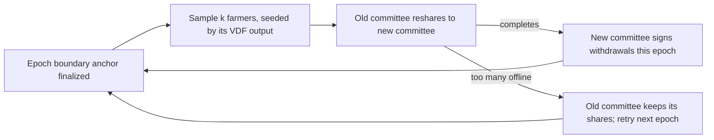

# Custody — a signing committee that grows with the network

Status: **design, partly implemented.** Threshold signing (FROST over secp256k1 → a BIP340
Taproot key-path spend), VDF-seeded committee sampling, and epoch resharing with failover exist.
This document fixes the model they're wired into. It holds real coins; read *Limits* before
believing any security claim.

## Goal

Coins deposited into Gavl (BTC now, LTC next) sit in a vault whose key **no single party holds**.
Withdrawals need a threshold of a committee drawn from the people running the network, and the
committee gets **larger and harder to capture as the network grows**. No bonds, no value caps, no
withdrawal-rate limit: security comes from the cost of controlling the network's space-time, not
from staked collateral.

## The invariant

```
gBTC outstanding == BTC in the vault    (likewise gLTC == LTC)
```

Mint only on a committee-attested, confirmed deposit; redeem only by burning, with the payout
built from the finalized burn. Concretely the fold checks
`reserves == free balances + pending withdrawals + pot` per asset.

## How it works

1. **Eligibility = recent farming.** A node is eligible for an epoch if it produced finalized
   anchors in the recent window (default: the last 2 epochs). Seats are weighted by anchors
   produced — i.e. by proven space-time — never by node count, so splitting one disk across many
   identities gains nothing, and farmers who left age out.
2. **Size scales with the network.** `k = min(eligible farmers, K_MAX)`; threshold
   `M = max(2, ceil(2k/3))`. Three farmers → 2-of-3. Hundreds of farmers → a K_MAX-seat committee.
   K_MAX is chosen by measurement (see *Testing*), starting at 31.
3. **Random, unpredictable selection.** Each epoch's committee is sampled with the boundary
   anchor's VDF output as the seed. The VDF can't be ground or predicted before it's computed,
   so an attacker can't steer seats to themselves.
4. **Rotation every epoch.** The outgoing committee reshares the *same* secret to the incoming
   one (proactive secret sharing). The group key — and therefore every deposit address — never
   changes; old shares become useless. To steal, an attacker must hold ≥ M seats of one randomly
   drawn committee *within one epoch*.
5. **One key, every coin.** BTC and LTC both verify BIP340 Schnorr over secp256k1 and both support
   Taproot, so one committee key backs both vaults. Deposit tweaks and attestation digests carry
   an asset tag so a signature for one coin can never be replayed for another.
6. **No trusted setup.** The first committee creates the key by DKG; no machine ever sees the
   whole key. This holds on every network, testnet included.
7. **Everyone watches.** Every node verifies that the committee only ever co-signs payouts that
   match finalized burns. A provable fault (signing two conflicting ceremony messages) is posted
   as a `custody.fault` op; the fold verifies the proof and **excludes** that producer from all
   future committees. There is no stake to slash — exclusion plus a public alarm is the response.



## Why bigger is safer

An attacker controlling a fraction `f` of the network's space-time captures a committee only if
the sample gives them ≥ M of k seats. Per-epoch capture probability:

| k | M | f = 10% | f = 25% | f = 33% | f = 45% |
|---|---|---|---|---|---|
| 3 | 2 | 2.8e-2 | 1.6e-1 | 2.6e-1 | 4.3e-1 |
| 7 | 5 | 1.8e-4 | 1.3e-2 | 4.3e-2 | 1.5e-1 |
| 15 | 10 | 1.9e-7 | 8.0e-4 | 7.9e-3 | 7.7e-2 |
| 31 | 21 | 1.6e-14 | 6.7e-7 | 8.0e-5 | 9.0e-3 |
| 63 | 42 | 3.2e-27 | 4.1e-12 | 4.8e-8 | 4.3e-4 |
| 101 | 68 | 1.4e-43 | 4.5e-19 | 1.9e-12 | 5.0e-6 |

Growth helps twice: more honest farmers lower `f`, and more farmers allow a larger `k`.

## Limits — what this is not

- **Theft is possible; it's expensive, not impossible.** The cost of an attack is controlling
  ~2/3 of the network's space-time for an epoch — buying or renting disk — not losing a bond. If
  the vault is worth more than that, theft pays. In a small network that rent is cheap: keep only
  what you can afford to lose in the vault until the network is large. There is no withdrawal-rate
  limit, so a captured committee can take everything in one epoch.
- **Small committees are weak.** At k = 3 (three farmers), an attacker with a third of the space
  wins the draw about a quarter of the time. The guarantees in the table only arrive with many
  independent farmers.
- **Funds can freeze.** If more than a third of a committee vanishes before handing off, nobody
  can sign until enough return. Larger committees and the recent-activity window reduce this;
  a failed reshare leaves the old committee in charge and retries next epoch. Resharing under
  churn is where systems like this break in practice, so it gets the heaviest testing.
- **Practical size ceiling.** DKG and resharing cost roughly k² point-to-point messages per epoch
  over Nostr relays; signing costs roughly k per withdrawal. The usable K_MAX is measured, not
  assumed.
- **Still a bridge.** Coins on Gavl are claims on a vault guarded by a sampled majority of the
  network. That trust is spread thin and rotated, but it is not zero.

## Testing (gates, in order)

1. **Unit:** sampling is byte-identical across nodes; a proven fault excludes the producer; a bogus
   fault proof is rejected; conservation holds through mint, withdraw, idle fee.
2. **Regtest acceptance:** committee-signed Taproot spends are accepted by real `bitcoind` and
   `litecoind` (`npm run test:regtest`).
3. **Churn:** 10–30 local nodes on regtest; random members are killed and restarted across many
   epochs. Pass = every epoch's reshare completes or cleanly retries, withdrawals keep being
   accepted by the regtest node, and the vault address never changes.
4. **K_MAX:** the churn run at k = 31, 63, 101; pick the largest k whose reshares complete
   reliably over Nostr.
5. **Public testnets** across independent machines.
